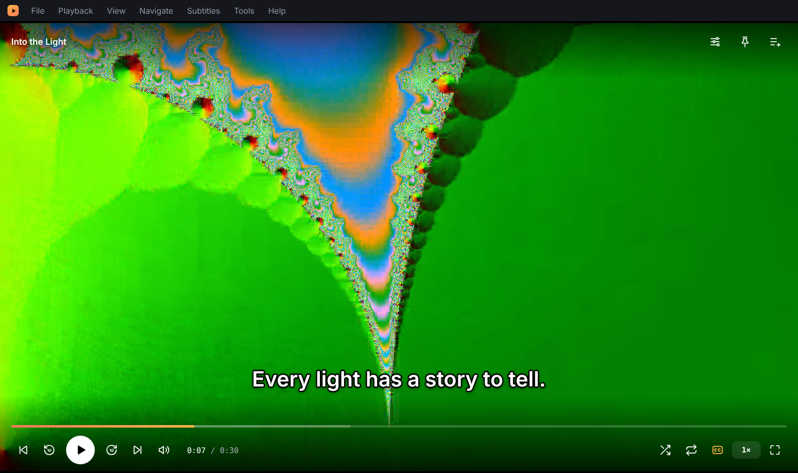
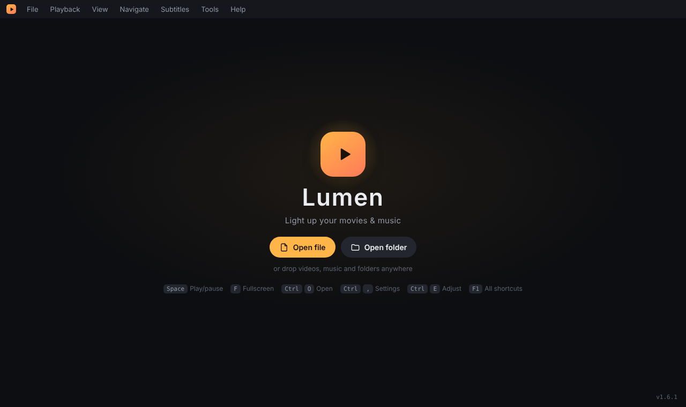
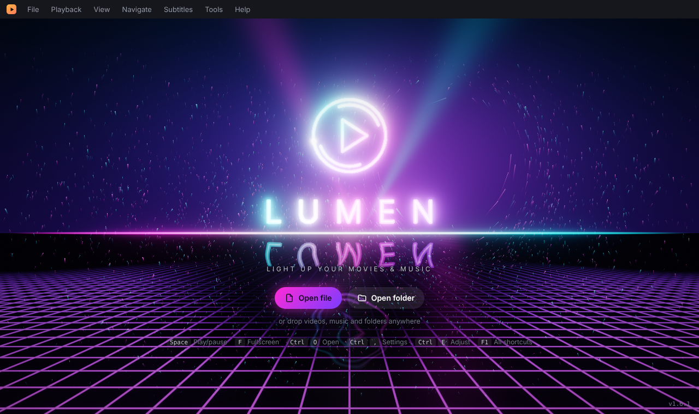
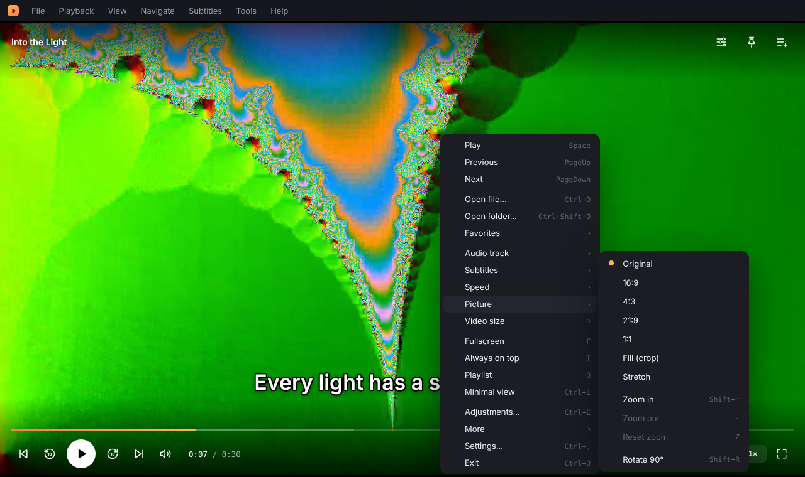
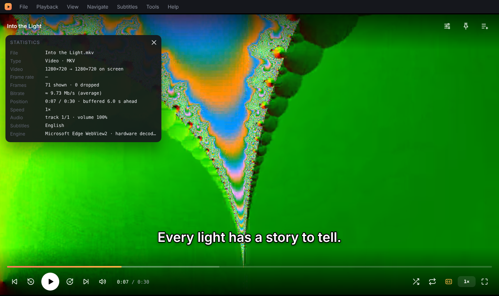
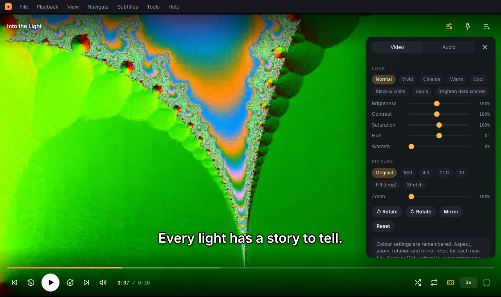
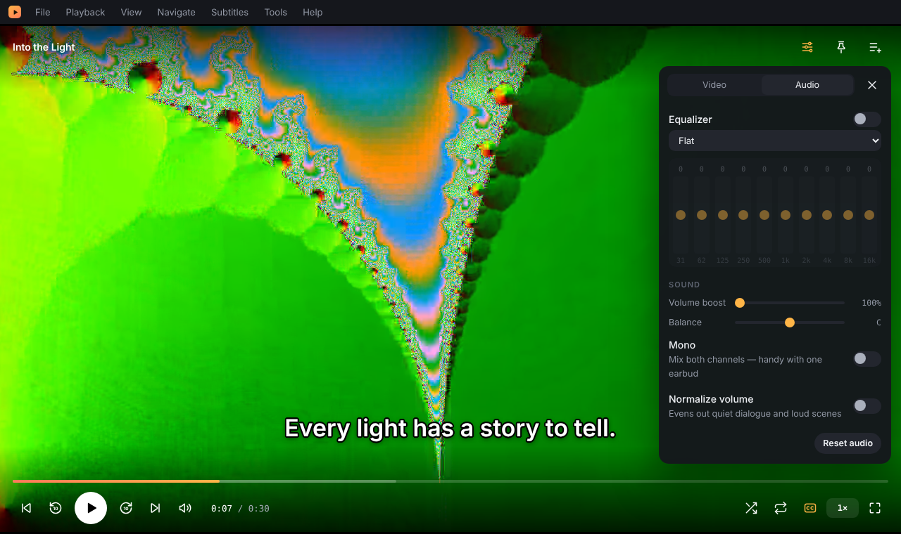
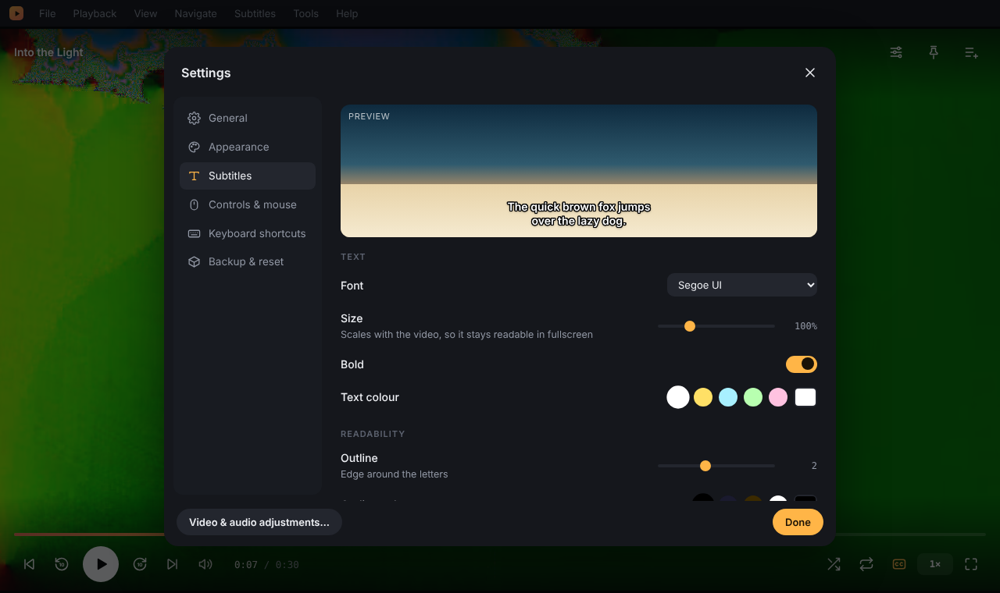
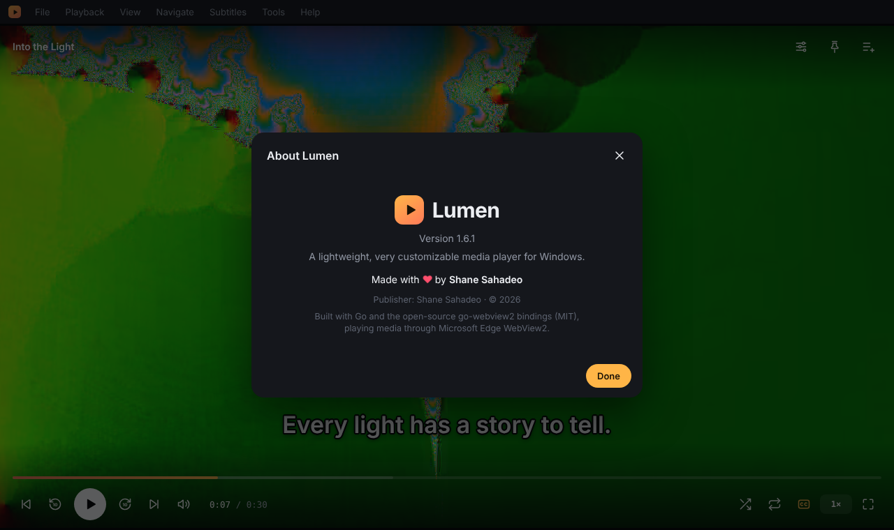

<div align="center">


# Lumen

**A lightweight, modern media player for Windows that you can make your own.**

Plays practically anything · installer or portable · no telemetry · no history unless you ask for it

[](https://github.com/shenvecthor/lumen/releases/latest)
[](https://github.com/shenvecthor/lumen/releases/latest)

ARM64 (Snapdragon / Surface) builds are on the [latest release page](https://github.com/shenvecthor/lumen/releases/latest).

[](https://github.com/shenvecthor/lumen/releases/latest)

[](LICENSE)

Made with ♥ by **Shane Sahadeo**



</div>

---

## Contents

- [Download](#download)
- [Highlights](#highlights)
- [All features](#all-features)
- [Screenshots](#screenshots)
- [Menus](#menus)
- [Keyboard shortcuts](#keyboard-shortcuts)
- [Supported formats](#supported-formats)
- [Privacy and your data](#privacy-and-your-data)
- [Building from source](#building-from-source)
- [How it works](#how-it-works)
- [Version history](#version-history)
- [Credits and license](#credits-and-license)

## Download

Get both from the [latest release](https://github.com/shenvecthor/lumen/releases/latest):

| Your PC | Installer | Portable |
|---|---|---|
| Most Windows PCs (Intel / AMD) | `Lumen-Setup-<version>-x64.exe` | `Lumen-<version>-portable-x64.zip` |
| Windows on ARM (Snapdragon laptops, Surface Pro X / 11) | `Lumen-Setup-<version>-arm64.exe` | `Lumen-<version>-portable-arm64.zip` |

All versions and SHA-256 checksums are on the [Releases page](https://github.com/shenvecthor/lumen/releases).

**Installer:** installs for your account only, so no administrator prompt (you can choose "all users" instead). It adds Lumen to the Start menu, to *Open with* for video and audio files and to Windows' Default Apps list, with an optional desktop shortcut. Uninstall from *Settings → Apps*; it asks whether to keep your settings.

**Portable:** unzip anywhere (a USB stick works) and run `Lumen.exe`. Keep the `engine` folder next to it. Nothing is installed; settings go to `%LOCALAPPDATA%\Lumen`.

**"Windows protected your PC":** the exe isn't code-signed yet, so SmartScreen may warn the first time. Click *More info → Run anyway*. You can compare the file's SHA-256 with the one on the release page if you want to be sure it's the original.

**Make it your default player:** after installing, open *Settings → Apps → Default apps → Lumen* and pick the file types, or right-click a video → *Open with* → *Lumen* → *Always*.

**Requirements:** Windows 10 or 11 with the Microsoft Edge WebView2 Runtime. It ships with Windows 11 and is already on almost every updated Windows 10 PC. If it's missing, Lumen offers to open Microsoft's download page.

## Highlights

- **Starts clean, every time.** Lumen always opens empty. It never reopens your last file or playlist by itself.
- **Plays practically anything.** Common files use the hardware decoding built into Windows; everything else (AVI, WMV, MPEG, TS, HEVC, DTS / Dolby audio, Blu-ray and DVD subtitles…) switches automatically to the bundled extended engine, libmpv. Same interface, same features.
- **Subtitles done properly.** Embedded MKV subtitles are found automatically; subtitles sit inside the picture with a safe margin from the edge, and a live-preview subtitle studio lets you style them.
- **Right-click for everything.** A quick menu at the cursor with playback, tracks, picture, window and settings.
- **Borrowed from MPC-HC.** Chapters, smart Next/Previous through chapters → playlist → folder, audio track switching, Go to time, statistics, volume normalization, video size presets, after-playback actions, favorites, thumbnails and playlists.
- **Touchpad-first.** Pinch to zoom exactly like a web page, two-finger scroll to move around, swipe to seek.
- **Window keeps the video's shape** while you resize it, so there are no black bars.
- **Make it yours.** Themes, accent colours, fonts, an optional neon look, remappable shortcuts, a configurable control bar and mouse.

## All features

### Two engines, one player
- **Windows' built-in player (Edge WebView2)** handles MP4, MKV and WebM with H.264, VP9 or AV1, and MP3, AAC, FLAC, Opus and Vorbis — fast to start and hardware-decoded.
- **The extended engine ([libmpv](https://mpv.io) with [FFmpeg](https://ffmpeg.org), LGPL builds)** plays everything else: AVI (DivX/Xvid), WMV/ASF, MPEG-1/2, VOB, MPEG-TS/M2TS, FLV, RealMedia, HEVC without the Store extension, Dolby Digital (AC-3/E-AC-3), DTS and TrueHD audio, APE, WMA, WavPack, AIFF and more, plus Blu-ray (PGS) and DVD subtitles and full ASS styling.
- **Automatic:** Lumen reads each file's header (not the whole file) and picks the engine. It tells you when the extended engine is used and why ("DTS audio", "AVI file"…). Settings → General → *Playback engine* lets you choose Automatic, Always extended, or Built-in only.
- **Everything keeps working** on both engines: controls, seek-bar previews, chapters, audio and subtitle tracks, subtitle styling, colour adjustments, EQ, boost, normalization, zoom and pinch, rotation, ambient light, statistics, snapshots and thumbnail sheets.

### Playback
- Play, pause, stop, previous/next, skip back/forward (5–30 s, your choice), frame-by-frame stepping while paused.
- Speed from 0.25× to 3×, with or without keeping voice pitch. The speed keys follow the preset list or step by ±0.05, ±0.1 or ±0.25. Pick a starting speed.
- Shuffle, repeat one / all, A–B loop.
- **Resume where you left off** for long videos (off by default).
- **Sleep timer:** 15 min to 1.5 h, or the end of the current file, with a countdown in the menu bar.
- **After playback:** do nothing, play the next file in the folder, play again, close the file, exit Lumen, sleep, hibernate or shut down. Set a default, or choose "this time only" from the Playback menu. Sleep, hibernate and shutdown give you a 15-second countdown you can cancel.
- **Seek bar previews:** hover the seek bar to see the frame at that point.
- Jump to 0–90 % with the number keys.

### Navigation (MPC-HC style)
- **Chapters** from MKV/WebM files: tick marks on the seek bar, the chapter name in the seek tooltip, and a chapter list in the Navigate menu, the quick menu and Go to.
- **Smart Next / Previous** (PageDown / PageUp): next chapter, then the next playlist item, then the next file in the same folder. Previous goes back to the start of the current chapter first if you're more than 3 seconds in.
- **Next / previous file in the folder** (Ctrl+PageDown / Ctrl+PageUp), in natural order (Episode 2 comes before Episode 10).
- **Go to…** (Ctrl+G): type `1:23:45`, `12:30`, `90` (seconds) or `50%`.

### Playlists, favorites and files
- Open files or whole folders, drag and drop anything onto the window, or add to the playlist without interrupting playback.
- **Playlists:** open `.m3u` / `.m3u8` files and save the current list as `.m3u8` (Ctrl+S).
- **Favorites** (Ctrl+D) remember the file and the exact position; open one and it continues from there. Organize or clear them any time.
- **Recent files:** opt-in only (Settings → General → History).
- **Single window:** double-clicking another file while Lumen is open hands it to the running window almost instantly instead of starting a second copy. Choose whether files from Explorer play now or join the playlist.

### Subtitles
- **Embedded subtitles** in MKV/WebM (SRT, SSA/ASS and WebVTT, including compressed tracks) are found and shown automatically, even in multi-GB files, in about a second.
- **Subtitle files next to the video** load automatically: `Movie.srt`, `Movie.en.srt`, `Movie.vtt`, `Movie.ass`. Or load one yourself (Ctrl+L) or drop it on the window.
- **Automatic track choice:** your preferred language first, then a matching subtitle file, then the track the MKV marks as default.
- **Drawn by Lumen inside the picture**, never on the black bars, with a safe gap from the edge (7 % by default, adjustable 0–30 %). They follow letterboxing, aspect changes and fullscreen, and step up above the control bar when it appears.
- **Subtitle studio** with live preview: 8 fonts, size, bold, text colour, outline thickness and colour, drop shadow, background box opacity and colour, top or bottom placement.
- While watching: delay −/+ 0.1 s (G / H), move up/down (Shift+↑ / ↓), smaller/bigger (Shift+[ / ]).

### Video
- **Adjustments panel** (Ctrl+E): brightness, contrast, saturation, hue and warmth, with presets (Vivid, Cinema, Warm, Cool, Black & white, Sepia, Brighten dark scenes).
- **Aspect ratio:** original, 16:9, 4:3, 21:9, 1:1, fill (crop) or stretch.
- **Rotate and mirror.**
- **Zoom up to 600 %** (you choose the maximum): pinch on a touchpad or touchscreen, Ctrl + mouse wheel, or the keyboard. It zooms toward the point under your fingers or cursor. Move around by dragging, two-finger scrolling or Ctrl+arrows. A minimap shows where you are.
- **Video size 50 / 100 / 200 %** (Alt+1 / 2 / 3) resizes the window to the video's real size.
- **Ambient light:** a soft glow of the picture's colours fills the black bars around the video.
- **Snapshots** (Shift+S) include your colour and rotation changes and are saved to `Pictures\Lumen`.
- **Save thumbnails** (Ctrl+T): one image with 9 to 48 evenly spaced frames, timestamps, and the file's name, resolution, length and size.

### Audio
- **10-band equalizer** with 11 presets or your own curve.
- **Volume boost** up to 250 %, left/right balance, mono mix (handy with one earbud).
- **Normalize volume:** evens out quiet dialogue and loud scenes.
- **Audio track switching** (Ctrl+A) for files with more than one audio track.
- **Music visualizer:** Bars, Wave, Halo or off. It stops drawing while paused or minimized.

### Window and view
- **Right-click quick menu** anywhere (or the Menu key / Shift+F10). It opens at the cursor, flips upward near the bottom of the window and works with the arrow keys.
- **Movable windows:** drag the adjustments panel, the subtitle popup, the statistics box and every dialog by its title. They stay inside the window, remember their place for the session, and a double-click on the title puts them back.
- **The window keeps the video's shape** while you resize it, taking the menu bar, playlist, rotation and aspect into account. Shift+F fits the window to the video at once, or have it done for every file.
- **Fullscreen** hides the menu bar, controls, seek bar and cursor until you move the mouse.
- **Always on top**, **minimal view** (Ctrl+1 hides the menu bar), and a playlist panel (Q).
- **Statistics** (Ctrl+J): resolution and on-screen size, measured frame rate, shown and dropped frames, average bitrate, buffer, chapter, audio track and subtitles.
- **Media information** (Ctrl+I).

### Make it yours
- **Themes:** Dark, Midnight (true black for OLED), Slate and Light.
- **8 accent colours** or any custom colour; 5 interface fonts.
- **Neon glow** around buttons, sliders and panels: Off (default), Soft or Neon (Shift+G).
- **Start screen:** Simple (default, nothing running in the background), a GPU-rendered **neon sign** with real bloom, a wet reflective floor, thousands of spark trails and light that follows your cursor, or a **light orb**. Animation can be Full, Calm or Still, and Calm is used automatically if Windows asks for reduced motion.
- **Control bar:** compact / normal / large, thin or thick seek bar, choose which buttons appear, total or remaining time, skip size.
- **Mouse:** choose what click, double-click and the wheel do. Optional "seek by side": double-click the left or right third to skip, the middle for fullscreen.
- **Touchpad:** pinch to zoom, two-finger move, two-finger swipe to seek; each can be switched off.
- **All 71 actions can be remapped** in Settings → Keyboard shortcuts; conflicts are resolved for you.
- **Export / import settings** as a small `.json` file to copy your setup to another PC.

## Screenshots

| | |
|---|---|
| <br>**Simple start screen** (default) | <br>**Neon start screen** (optional, GPU-rendered) |
| <br>**Right-click quick menu** | <br>**Statistics** (movable) |
| <br>**Video adjustments** | <br>**Equalizer, boost and normalization** |
| <br>**Subtitle studio with live preview** | <br>**About** |

## Menus

| File | Playback | View | Navigate | Subtitles | Tools | Help |
|---|---|---|---|---|---|---|
| Open file… | Play / Pause, Stop | Fullscreen | Next / previous (chapter, then file) | Off / track list | Settings… | Keyboard shortcuts |
| Open folder… | Previous / Next | Always on top | Next / previous file in folder | Load subtitle file… | Video & audio adjustments… | Customize shortcuts… |
| Add to playlist… | Jump back / forward | Playlist, Minimal view | Chapters ▸ | Delay −/+ 0.1 s, Reset | Equalizer… | About Lumen |
| Load subtitle file… | Speed ▸, Shuffle, Repeat ▸ | Video size ▸, Statistics | Go to… | Position ▸ | Media information… | |
| Save playlist…, Recent files ▸, Favorites ▸ | Audio track ▸, Normalize volume | Theme ▸, Accent colour ▸ | | Subtitle style… | Snapshot, Save thumbnails…, Snapshots folder | |
| Close · Exit | A–B loop, Sleep timer ▸, After playback ▸ | Ambient light, Aspect ▸, Rotate & mirror ▸, Control bar ▸, Visualizer ▸ | | | | |

Menus open with Alt + the underlined letter (Alt+F, Alt+P, …). Right-click anywhere for the quick menu.

## Keyboard shortcuts

These are the defaults. Every one can be changed in Settings → Keyboard shortcuts, and F1 shows the current list.

| Key | Action | Key | Action |
|---|---|---|---|
| Space / K | Play / pause | F / Enter / double-click | Fullscreen |
| ← / → | Seek (step set in Settings; Shift = 30 s) | Esc | Leave fullscreen |
| J / L | Seek 10 s | N / P | Next / previous |
| ↑ / ↓ / mouse wheel | Volume | Q | Playlist |
| M | Mute | S / R | Shuffle / repeat |
| [ / ] / \ | Slower / faster / reset | C | Cycle subtitles |
| G / H | Subtitle delay −/+ 0.1 s | B | A–B loop (start, end, clear) |
| Shift+S | Snapshot | T | Always on top |
| 0–9 | Jump to 0–90 % | , / . | Frame step (paused) |
| Ctrl+O / Ctrl+Shift+O | Open file / folder | Ctrl+L | Load subtitles |
| Ctrl+W | Close | Ctrl+, / Ctrl+I | Settings / media info |
| Ctrl+Q | Exit | F1 | Shortcut list |
| Ctrl+E | Adjustments panel | E | Equalizer on/off |
| A / Shift+A | Ambient light / cycle aspect | Shift+R | Rotate 90° |
| Shift+= / − | Zoom in / out | Shift+T | Next theme |
| Shift+↑ / ↓ | Move subtitles up / down | Shift+[ / ] | Subtitles smaller / bigger |
| Pinch · Ctrl+wheel | Zoom where you point | Z / Ctrl+0 | Reset zoom |
| Drag · two-finger scroll | Move the zoomed picture | Ctrl+arrows | Move the zoomed picture |
| Shift+F | Fit window to video | Shift+G | Cycle neon glow |
| PageDown / PageUp | Next / previous chapter, then file | Ctrl+PageDown / Up | Next / previous file in folder |
| Ctrl+G | Go to time | Ctrl+J | Statistics |
| Ctrl+A | Next audio track | Alt+1 / 2 / 3 | Video size 50 / 100 / 200 % |
| Ctrl+D | Add to favorites | Ctrl+S | Save playlist |
| Ctrl+T | Save thumbnails | Ctrl+1 | Minimal view |
| Right-click · Menu key · Shift+F10 | Quick menu | Double-click a window's title | Put a moved window back |

## Supported formats

| Kind | Built-in engine (Edge WebView2) | Extended engine (libmpv + FFmpeg) |
|---|---|---|
| Containers | MP4, M4V, MOV, MKV, WebM, Ogg | AVI, DivX, WMV/ASF, MPEG-1/2, VOB, MPEG-TS, M2TS/MTS, FLV/F4V, 3G2, RealMedia, OGM, MXF, DV, NUT, raw H.264/HEVC — plus everything on the left |
| Video | H.264, VP8, VP9, AV1 | HEVC/H.265 (hardware-decoded, no Store extension needed), MPEG-4 Part 2 (DivX/Xvid), MPEG-1/2, VC-1/WMV, ProRes, Theora and more |
| Audio | AAC, MP3, FLAC, Opus, Vorbis, WAV | Dolby Digital (AC-3), E-AC-3, DTS / DTS-HD, TrueHD, ALAC, APE, WMA, WavPack, TTA, Musepack, AIFF, AMR, DSD, PCM, tracker modules |
| Subtitles | SRT, SSA/ASS, WebVTT (files or embedded) | the same with full ASS styling, plus Blu-ray PGS, DVD VobSub and DVB subtitles |
| Playlists | M3U, M3U8 (local files; web addresses in them are skipped) | |

The extended engine ships in the installer and the portable zip. If its `engine` folder is missing, Lumen still plays everything in the left column.

## Privacy and your data

- **No telemetry, no accounts.** Lumen makes no internet connections of its own; everything stays on your PC.
- **No history by default.** Lumen always starts empty. Recent files and resume positions are off unless you turn them on.
- **Everything Lumen saves** is in one file, `%LOCALAPPDATA%\Lumen\state.json`: your settings, volume, favorites, and (only if you enabled them) recent files and resume positions. Delete it to reset Lumen completely, or use Settings → Backup & reset.
- **Snapshots and thumbnails** go to `Pictures\Lumen`.
- **Media is served only to Lumen's own window**: a loopback-only server on a random port that needs a random 256-bit per-session token, only serves files you explicitly opened, rejects foreign `Host` headers (DNS rebinding) and refuses anything other than reading.

## Building from source

You need Go 1.24 or newer. Lumen itself is pure Go (no C compiler) and cross-compiles from Windows, macOS or Linux. The extended engine is loaded at run time from an `engine` folder next to `Lumen.exe`.

```sh
git clone https://github.com/shenvecthor/lumen.git
cd lumen

# Windows resources: icon, version info, manifest (needs go-winres once)
go install github.com/tc-hib/go-winres@latest
go-winres make --arch amd64,arm64

# x64 and ARM64 builds
GOOS=windows GOARCH=amd64 CGO_ENABLED=0 go build -trimpath -ldflags "-H windowsgui -s -w" -o Lumen.exe .
GOOS=windows GOARCH=arm64 CGO_ENABLED=0 go build -trimpath -ldflags "-H windowsgui -s -w" -o Lumen-arm64.exe .

# tests (MKV reader, window-shape maths)
go test ./...
```

On Windows (PowerShell), set the variables with `$env:GOOS="windows"` and so on, or simply run `go build -ldflags "-H windowsgui -s -w" -o Lumen.exe .`

**The extended engine** (LGPL libmpv + FFmpeg for x64 and ARM64) is compiled from source by the [Engine workflow](.github/workflows/engine.yml) on GitHub Actions and published as an `engine-<n>` release; the [Release workflow](.github/workflows/release.yml) adds it to the installers ([Inno Setup](https://jrsoftware.org/isinfo.php) script in `installer/`) and portable zips. To build your own: run the Engine workflow in your fork, or unzip an engine release into an `engine` folder next to your `Lumen.exe`.

**Development:** `go run .` on Linux or macOS starts a small harness that serves the interface to a normal browser for testing; `LUMEN_UI_DIR=. go run -tags lumenmpv .` also serves the UI straight from the source folder and drives a real libmpv (install `libmpv-dev`). On Windows, set `LUMEN_DEBUG=1` to enable DevTools (F12), the browser's own context menu and browser shortcuts.

### Project layout

| Path | What it is |
|---|---|
| `main_windows.go` | Window, WebView2 setup, dialogs, bindings between the interface and Windows |
| `server.go` | Loopback media server, folder and playlist expansion, subtitle discovery |
| `mkv.go` | Matroska/EBML reader for embedded subtitles, chapters and track codecs |
| `probe.go` | Chooses the engine for each file from its header (MKV and MP4 codecs, container type) |
| `mpv.go`, `mpv_windows.go` | libmpv engine: player, events, frame grabber; Windows loader (plain syscalls, no cgo) |
| `engine_windows.go` | The native video window under the interface, and the engine's bindings |
| `engine/shim.c` | Tiny helper DLL built with the engine (lets ARM64 call `mpv_wait_event`) |
| `installer/lumen.iss` | Inno Setup installer script |
| `aspect.go` | Window-shape maths (aspect lock, fit, video size presets) |
| `instance_windows.go` | Single-window handoff |
| `main_other.go` | Development harness for non-Windows systems |
| `ui/` | The interface: `index.html`, `app.css`, `app.js`, `mkv.js` (in-page MKV reader for dropped files), `neon-gl.js` (WebGL2 start screen) |
| `winres/` | Icon, version information and manifest |
| `third_party/go-webview2` | Vendored WebView2 bindings with a small extension |

## How it works

- **Backend:** Go with the open-source [go-webview2](https://github.com/jchv/go-webview2) bindings (MIT), vendored with a small addition that exposes WebView2 settings and a `WM_SIZING` hook for the aspect-locked window.
- **Frontend:** plain HTML, CSS and JavaScript embedded in the exe. No framework, no bundler.
- **Playback:** the Edge WebView2 media engine for common formats, so decoding uses the same hardware acceleration as Windows itself. For everything else, libmpv draws into a native child window that sits *under* the WebView2 interface; the page turns transparent over the picture, so every control, menu and panel works unchanged on top. A second, hidden libmpv instance decodes single frames on the CPU (its software renderer) for seek-bar previews, thumbnail sheets, ambient light and the zoom minimap.
- **Subtitles:** read from the file by a small Matroska/EBML parser that skips video and audio data and reads only subtitle blocks and chapters. Lumen draws subtitles itself so they can sit inside the picture.
- **Audio:** a Web Audio graph (10 biquad filters, compressor for normalization, gain, stereo panner, analyser) that's only built when an audio feature or the visualizer needs it.
- **Neon start screen:** a WebGL2 renderer with HDR bloom, instanced GPU sparks and ACES tone mapping. It steps its quality down automatically, falls back to CSS on slow or software-only graphics, and stops completely while a video plays.
- **Single window:** a named mutex plus `%LOCALAPPDATA%\Lumen\instance.json`; a second launch posts its file list (token-protected, loopback only) to the running window and exits.

## Version history

See [CHANGELOG.md](CHANGELOG.md) for everything that changed in each version.

## Credits and license

Lumen is designed and published by **Shane Sahadeo**.

- [go-webview2](https://github.com/jchv/go-webview2) by John Chadwick and contributors (MIT).
- [mpv](https://mpv.io) (libmpv, built LGPL-2.1-or-later) and [FFmpeg](https://ffmpeg.org) (LGPL build) power the extended engine, with libass, libplacebo, dav1d and others; the full list and licenses ship in `engine\THIRD-PARTY-NOTICES.txt` and `engine\licenses`.
- Several navigation and playback features are inspired by [MPC-HC](https://github.com/clsid2/mpc-hc), the classic Windows player.

Lumen itself is released under the [MIT License](LICENSE). The extended engine's libraries keep their own licenses (LGPL-2.1-or-later and permissive licenses); they are separate DLLs you can replace with your own builds.
